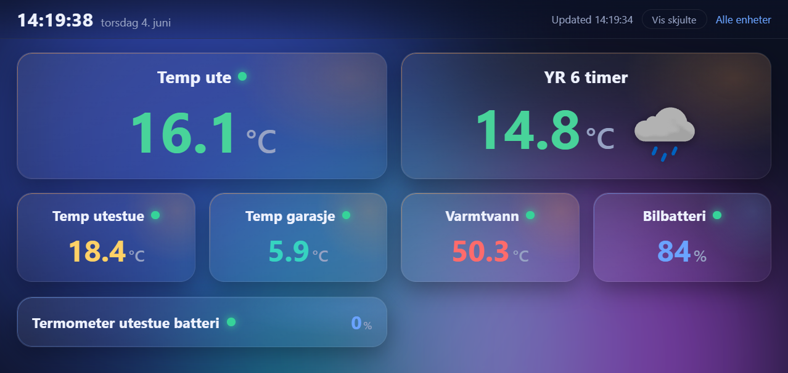

# Homey → Nest Hub Dashboard

A small, self-hosted web page for your local network that shows live capability values for a
hand-picked set of devices on your Athom Homey Pro. It's designed to sit fullscreen on a
**wall-mounted tablet or a Google Nest Hub**, but works in any browser. It talks to Homey's
**local API** with a Personal Access Token, runs as a **Docker container**, and you choose
exactly which devices and capabilities appear via a `config.json` file.

<!-- Add a screenshot here: drop an image at docs/screenshot.png and it will show below. -->


```
Browser (LAN)  ──>  Node/Express container  ──>  Homey local API (http://<homey-ip>)
                    · serves the dashboard       (token kept server-side, never in the browser)
                    · proxies + caches requests
```

Highlights: colourful glassmorphism UI with an animated background and live clock, YR weather
icons, configurable card sizes, conditional visibility rules (`showIf`), a "show hidden"
toggle, touch **sliders** for zip screens and blinds, and a discovery page to find
device/capability IDs. Norwegian labels out of the box.

## What you need

1. A **Homey Pro** reachable on your LAN, and its IP address (Homey app → Settings → General, or your router).
2. A **Personal Access Token / API Key**: go to <https://my.homey.app> → **Settings → API Keys** → create a key with read access to **Devices** and **Zones**. Copy the full token (looks like `ba78f646-...:21b9f8d2...`).
3. **Docker** + **Docker Compose** on an always-on machine on the same network (PC, NAS, Raspberry Pi…).

## Setup

From this folder:

```bash
# 1. Configure connection
cp .env.example .env
#    edit .env -> set HOMEY_ADDRESS and HOMEY_TOKEN

# 2. Start with an empty config so the discovery page works
mkdir -p config
echo '{ "entities": [] }' > config/config.json

# 3. Build and run
docker compose up -d --build
```

Open `http://<host-ip>:8080/discover.html` on any device on your network. This lists **every**
Homey device with its `deviceId`, capability names (e.g. `measure_temperature`, `onoff`,
`alarm_contact`) and current values. Use the search box and the **Copy ID** buttons.

## Choosing what to display

Edit `config/config.json` (start from `config.example.json`). Entities are grouped **by size** —
`entities` is an object keyed by size, and each size holds an array of cards:

```json
{
  "title": "Home Dashboard",
  "entities": {
    "weather": [
      {
        "deviceId": "yr-device-id",
        "label": "Vær ute",
        "capabilities": ["measure_temperature", "weather_description"]
      }
    ],
    "small": [
      {
        "deviceId": "9af...door-id",
        "label": "Front door",
        "capabilities": ["alarm_contact"]
      }
    ],
    "list": [
      {
        "deviceId": "1bd...dishwasher-id",
        "label": "Oppvask",
        "capabilities": ["remaining_time"],
        "showIf": "!=empty"
      }
    ]
  }
}
```

- the **size** key (`big`, `small`, `list`, `weather`) groups the cards — see box levels below.
- `deviceId` — copy from the discovery page.
- `label` — what to show as the card title (optional; defaults to the device name).
- `capabilities` — the capability IDs to display. Omit or leave empty to show **all** of a device's capabilities.
- `showIf` — optional condition; the card is shown only while it holds. Forms:
    - Numeric: `"<20"`, `"<=20"`, `">80"`, `">=80"`, `"==0"`, `"!=0"`.
    - Boolean: `"==true"`, `"==false"`, `"!=true"`, `"!=false"`.
    - Emptiness: `"!=empty"` (show only when **not** empty) or `"==empty"`. "Empty" means `null`, `false`, `0`, blank, or an all-zero string like `00:00`.
    - Text/enum: `"==mowing"`, `"!=docked"`, or a comma-separated set — `"!=docked,charging"`. Enum capabilities are compared against their **id** (`docked`), not their title (`Docked`); matching is case-insensitive. Look the ids up on the discovery page.

    Examples: a battery tile that only appears when low — `"capabilities": ["measure_battery"], "showIf": "<20"`; a motion alert only while active — `"showIf": "==true"`; a dishwasher timer that hides at `00:00` — `"capabilities": ["remaining_time"], "showIf": "!=empty"`. (Values of the wrong type are ignored; if a card has several matching values, all must satisfy the condition. `"==true"` matches only boolean `true`, not the number `1`; a text rule only looks at string values, so a card with none stays hidden.)

### Box levels

The size group a device sits under chooses one of seven levels:

- **`big`** — extra-large centered value, **2 per row**.
- **`small`** (the default if you used an unknown size key) — centered value, **4 per row**.
- **`list`** — title, status dot and the value(s) all on **one line**, no labels. List cards are gathered into a section **below** all the other cards, 2 per row.
- **`weather`** — title on top, then the value(s) on one line below with no labels — ideal for a temperature plus a `weather_description` icon (`"capabilities": ["measure_temperature", "weather_description"]`). Spans 2 columns in the top grid.
- **`slider`** — a **control**, not a readout: drag or tap to set a position on one or more devices at once. See [Sliders](#sliders-zip-screens-blinds) below. 2 per row, in their own section between the top grid and the lists.
- **`thermostat`** — also a **control**: an on/off switch in the header and a dial for the target temperature. See [Thermostats](#thermostats) below. Takes one slot in the top grid, like a Small.
- **`light`** — a **control**: a switch, plus a dim track when the lamp has one. See [Lights](#lights) below. Takes one slot in the top grid.

Big and Small show a single centered value; if you give them more than one capability they fall back to labelled rows. Big, Small and Weather share the top grid and can mix on the same row (a Big or Weather takes the space of two Smalls). Cards appear in the order listed in `config.json` within each section.

**Config changes need no restart.** `config.json` lives in `config/`, which is bind-mounted, and
it is re-read on every request — so saving the file is enough. Open dashboards pick it up on
their next refresh, within about 5 seconds.

The directory is mounted rather than the file itself, and that matters: a single-file bind mount
is pinned to the file that existed when the container started, so the first time an editor saves
by writing a new file and renaming it over the old one — which most editors do — reads inside the
container start failing with `ENODATA` and keep failing until you restart. Mounting `config/`
means the filename is resolved fresh on every read.

If the file can't be read or the JSON is malformed, the dashboard keeps showing the last config
that parsed and puts a banner at the top saying why, quoting the parser's line number for a syntax
error. It clears itself once the file is readable again. Sliders keep working throughout.

**Code changes do need a rebuild.** `server.js` and `public/` are copied into the image, not
mounted, so after editing either one:

```bash
docker compose up -d --build
```

`docker compose restart` alone will keep running the old image — which is easy to mistake for the
change not working.

The dashboard at `http://<host-ip>:8080/` auto-refreshes every 5 seconds (in place, no flicker).
Booleans render as **Ja/Nei** (or Alarm/Clear for `alarm_*` capabilities); numbers show with
their units and a colour scale for temperatures; a status dot shows online / unavailable / alarm.
Enum capabilities can be shown in Norwegian via the `VALUE_LABELS` map in `public/index.html`
(capability id → value id → label) — `mower_state` is translated there. This is display only:
`showIf` still matches the raw value id, so a rule like `"!=docked"` is unaffected.
The header has a live clock, a **Vis skjulte** ("show hidden") toggle that reveals cards normally
hidden by their `showIf` rule, and an **Alle enheter** link to the discovery page.

### Config reference

| Key / property  | Where        | Purpose                                                                                  |
| --------------- | ------------ | ---------------------------------------------------------------------------------------- |
| size            | grouping key | `big`, `small`, `list`, `weather`, `slider`, `thermostat` or `light`. The card's layout/level. |
| `deviceId`      | property     | Homey device id (copy from the discovery page).                                          |
| `label`         | property     | Card title. Defaults to the device name.                                                 |
| `capabilities`  | property     | Capability ids to show. Omit/empty = all of the device's capabilities.                   |
| `showIf`        | property     | Show only when the condition holds: numeric (`<20`), boolean (`==true`), text/enum (`!=docked`), or `!=empty`. Ignored on sliders. |
| `deviceIds`     | slider only  | The devices the slider drives. Each item is an id string, or `{ "name": …, "id": …, "min": …, "max": … }`. |
| `capability`    | slider only  | Capability to write. Default `windowcoverings_set`; blinds exposed as dimmable devices use `dim`. |
| `min` / `max`   | slider only  | How far a screen travels, in % down. On a member it applies to that device; on the card it's the default for members that don't say. Default `0` / `100`. |
| `step`          | slider only  | Snap increment in %, on the slider's own 0–100 scale. Default `5`.                        |
| `invert`        | slider only  | Flip the direction if 100 % closes the wrong way. Default `false`. See below.             |
| `min` / `max`   | thermostat   | Ends of the dial, in degrees. Default: whatever the capability itself accepts.            |
| `step`          | thermostat   | Snap increment in degrees. Default: the capability's own step, else `0.5`.                |
| `capability`    | thermostat   | The temperature to write. Default `target_temperature`.                                  |
| `switchCapability` | thermostat | The capability behind the switch. Default `onoff`.                                       |
| `switchCapability` | light     | The capability behind the switch, or a **list** of them for a multi-gang device wired to one lamp. Default `onoff`. |
| `switches`      | light        | A named row per channel: `[{ "capability": "switch_1", "name": "Kanal 1" }, …]`. Use this instead of `switchCapability` when the gangs are separate lamps. |
| `capability`    | light        | The dimmer. Default `dim`. Written as Homey's 0..1; the card shows 0-100 %.               |
| `dim`           | light        | `false` makes a dimmable lamp behave as a plain switch. A lamp with no dimmer needs nothing. |
| `step`          | light        | Snap increment for the dimmer, in %. Default `5`.                                        |
| `readonly`      | light        | `true` when the app reports the capability as setable but never registered a listener, so writes always fail. The card shows the state instead of a switch. |

Top-level keys: `title` (browser tab / document title) and `entities` (the size→array object above).
A flat array of entries (each with its own `deviceId` and `size`) is still accepted for backward compatibility.

## Sliders (zip screens, blinds)

A `slider` card writes back to Homey. Everything else in this dashboard is read-only, so
this is the one place where the API key needs **write** access.

```json
"slider": [
  {
    "label": "Utestue zip",
    "deviceIds": [
      { "name": "Utestue zip sør",  "id": "dcc9a30a-…", "max": 97 },
      { "name": "Utestue zip vest", "id": "d6dc87b3-…" }
    ],
    "step": 5
  }
]
```

Each item of `deviceIds` is either a bare id string or an object. The object form takes a
**`name`**, which exists only to keep `config.json` readable — nothing depends on it matching
what Homey calls the device. It is used when a member has to be named on screen ("Utestue zip
sør: not setable"), and otherwise Homey's own device name is used.

Here the slider runs 0–100 % and both screens hit their own end stop at 100 %: vest is written
`windowcoverings_set: 1`, sør `0.97`. At 50 % vest goes to 50 % closed and sør to 48.5 % — half
of its own travel — so the two stay visually level.

**Positions are always "% down": `0` = fully open, `100` = fully closed** — the same direction
these screens report `windowcoverings_set` in (`0` = open, `1` = closed), so by default the raw
value is simply the fraction closed. Homey's *documented* convention is the opposite; if a device
follows that (or is just wired backwards), put `"invert": true` on its card and the server flips
it. Check on `/discover.html` which way a device reads before assuming.

**Not every blind uses `windowcoverings_set`.** Some are exposed as dimmable devices and take
`dim` instead — if a slider reports `No windowcoverings_set capability`, look the device up on
`/discover.html` and set `"capability": "dim"` on that card. Expect the direction to differ too:
in this house the zips run `windowcoverings_set` 0 = open, while the `dim` blinds run 1 = open,
so that card also needs `"invert": true`. Direction is per card, so mixed hardware is fine.

- **One slider, several screens.** List every device under `deviceIds` and the card sets them
  all to the same position in one go. The position shown is the average of the members; when
  they disagree by more than one step the card says *ulik posisjon*.
- **Travel limits.** `min`/`max` describe how far a screen actually goes. **The slider is always
  0–100 %**; a member's range is what that maps onto, so a zip whose fabric starts folding past
  97 % down gets `"max": 97` and reaches *its* end stop when the slider reads 100 %. Nothing on
  screen shows 97 — the limit is a property of the hardware, not something to aim at. Put the
  range on the member it applies to; on the card it just becomes the default for members that
  don't state their own.
- **Sent on release.** Dragging only moves the thumb; the command goes out once, when you let
  go. Tapping anywhere on the track jumps there. The track is the whole control — there are no
  `Opp`/`Ned`/`−`/`+` buttons; `step` still quantises what a drag can land on.
- **`showIf` is ignored** on sliders — a control that disappears is not a control.
- The commanded position stays on screen while the screens travel (the live reading is shown
  next to it as *på vei (45 %)*), and the poll can never yank the thumb out from under your
  finger. If a device fails the card says so instead of silently snapping back.

### Requirements

1. **A write-capable API key.** At <https://my.homey.app> → **Settings → API Keys**, the key in
   `HOMEY_TOKEN` needs **write** on Devices. A read-only key makes the dashboard work exactly
   as before, but sliders will report an error when you move them.
2. The devices must expose the capability as **setable** — check on `/discover.html`. The server
   refuses to write a capability a device doesn't have or can't set, and tells you which one.

### Security

A slider means anyone who can reach the dashboard can move your screens, and there is still no
authentication (see [Security](#security) above). The write path is deliberately narrow:
`POST /api/set` takes a **card key**, never a device id or capability name, so only devices you
listed under a `slider` card can be written, and only on that card's capability. Everything is
clamped server-side. Keep it on the LAN.

## Pages (one screen per room)

The dashboard can serve more than one page from the same config file and the same
HTML — one per display. The root page is the top-level `entities`, exactly as before;
extra pages go under `pages`:

```json
{
  "title": "Home Dashboard",
  "label": "Kjøkken",
  "entities": { "...the kitchen display..." },
  "pages": {
    "utestue": {
      "title": "Utestue",
      "label": "Utestue",
      "entities": { "...the sunroom display..." }
    }
  }
}
```

`http://<host-ip>:8080/utestue` then serves that page's cards. Each page's `label`
becomes a link in the top right of every *other* page, so the displays link to each
other with no extra config. `title` is the browser/document title.

- **Card keys are per page.** `slider:0` on `/utestue` and `slider:0` on `/` are
  different devices, so every write carries its page and is checked against that
  page's card list. The write whitelist stays exactly as narrow as it was.
- Extra pages lay themselves out for whatever screen they are on
  (`repeat(auto-fit, minmax(...))`) rather than the root page's fixed four columns,
  and their controls get bigger finger targets — they are meant to be touched, not
  read from across a room.
- The same device may appear on as many pages as you like.

## Lights

A switch, plus a dim track when the lamp has one:

```json
"light": [
  { "deviceId": "CEILING-LAMP-ID", "label": "Taklys" },
  { "deviceId": "TWO-GANG-SOCKET-ID", "label": "Utelys",
    "switchCapability": ["switch_1", "switch_2"], "readonly": true }
]
```

- A device with **no dim capability** simply renders as a plain switch — that is not
  an error worth a warning light. `"dim": false` forces the same on a lamp that has
  one.
- **Two keys, two behaviours, no flag between them.** `switchCapability: ["switch_1",
  "switch_2"]` gangs the channels into *one* switch: it reads as on when every gang is
  on, a tap writes them all, and the card says `ulik` when they disagree. `switches:
  [{capability, name}, …]` gives each channel its **own labelled row and switch** inside
  the same card, each with its own state — that is the one to use when the gangs are
  separate lamps:

  ```json
  { "deviceId": "TWO-GANG-DEVICE-ID", "label": "Utelys",
    "switches": [
      { "capability": "switch_1", "name": "Kanal 1" },
      { "capability": "switch_2", "name": "Kanal 2" }
    ] }
  ```

  A row write carries `channel: <index>` and touches only that capability. Rename the
  channels in `config.json`; nothing else needs to change.
- **Setting the dimmer usually switches the lamp on** — that is the device's own
  behaviour, not the dashboard's. Some lamps also report `dim: 0` when switched off,
  so the remembered level goes with them.
- `"readonly": true` is for a device whose app reports the capability as setable but
  never registered a listener for it, so `setCapabilityValue` always fails with
  *Missing Capability Listener*. The card then shows **På/Av** instead of a switch
  that could only ever fail. The Namron two-gang switch (`net.filllip-namron`,
  product 4512768) is one of these — it can be read but not written from Homey's API,
  and the app offers no flow action card for it either.

## Thermostats

The second writable card: an on/off switch in the header and a dial for the target temperature.
It takes one slot in the top grid, the same width as a Small.

```json
"thermostat": [
  {
    "deviceId": "HEATER-DEVICE-ID",
    "label": "Varme utestue"
  }
]
```

That is the whole minimum — the dial reads its own range and step from the device. Add `min`,
`max` or `step` when the device's range is wider than you want on a wall: a heater that accepts
5–45 °C is fine as a dial, but 5–30 gives you far more room per degree.

- **The switch is the only tap target in the header, the dial the only one below it**, so a finger
  on one can never move the other. The switch answers immediately and keeps its new state until
  the poll agrees with it.
- **The dial is dragged like a slider track**: put a finger anywhere on it and move around the
  arc. It is a 270° arc with the gap at the bottom, and dragging into that gap snaps to the
  nearer end, so both end stops stay reachable. The value is sent **on release**.
- The arc and the numeral take the same temperature colour the readout cards use, and go grey
  when the device is off — the dial still works there, so you can set a target before switching on.
- Like sliders, thermostat cards ignore `showIf`: a control that disappears is not a control.
- The line under the dial is where a failed write, `utilgjengelig` or `kan ikke stilles` shows up.
  It is the only feedback there is, so don't remove it.

The same requirements as sliders apply: a **write-capable** `HOMEY_TOKEN`, and the device must
expose `onoff` / `target_temperature` as **setable** (check `/discover.html`). The write path is
just as narrow — `POST /api/set` takes the card key `thermo:<n>`, and only the two capabilities
that card names, on that one device, can ever be written. The temperature is clamped server-side
to the same range the dial draws.

## Weather icons (YR)

The capability `weather_description` is rendered as a **YR weather icon** instead of text.
The value is matched against English and Norwegian (bokmål/nynorsk) descriptions as well as
raw met.no symbol codes (e.g. `partlycloudy_day`), so `"Clear sky"`, `"klarvær"`, and
`"clearsky"` all resolve to the same icon. Day/night variants are chosen by local time
(06:00–21:00 = day), unless the value itself carries a `_day` / `_night` suffix. Unrecognised
values fall back to showing the text.

The icons are bundled in `public/icons/weather/` and the lookup table in
`public/weather-symbols.js` — both generated from
[`@yr/weather-symbols`](https://github.com/YR/weather-symbols) (icons © 2015–2017 Yr /
met.no, MIT licensed). Everything is served locally, so no internet access is needed.

Put the YR forecast device on the dashboard like any other, e.g.:

```json
{ "deviceId": "yr-device-id", "label": "Vær", "size": "big", "capabilities": ["weather_description"] }
```

## Running without Docker (optional)

Requires **Node.js 24+** (the `homey-api` client mandates it).

```bash
npm install
HOMEY_ADDRESS=http://192.168.1.50 HOMEY_TOKEN=xxx node server.js
# -> http://localhost:3000
```

## Endpoints

| Path            | Purpose                                                        |
| --------------- | ------------------------------------------------------------- |
| `/`             | The dashboard (configured devices).                           |
| `/discover.html`| Lists all devices/capabilities with IDs for setup.            |
| `/api/state`    | JSON: only the configured entities + current values. `?page=<name>` selects an extra page (omit for the root dashboard). Add `showHidden=1` to also return `showIf`-hidden cards (flagged `hidden: true`). |
| `POST /api/set` | Write to one control. Body carries the card key, the `page` it belongs to, and the value: `{ "key": "slider:0", "position": 45 }` (% down), `{ "key": "thermo:0", "onoff": true, "temperature": 21 }`, or `{ "key": "light:0", "onoff": true, "level": 60 }` (% brightness). Only cards defined on that page in `config.json` are accepted. |
| `/<page>`       | An extra page, e.g. `/utestue`. Same HTML as `/`; the card list comes from `pages.<page>` in `config.json`. |
| `/api/discover` | JSON: all devices + all capabilities.                         |
| `/api/health`   | `{ "ok": true }` health check (used by the Docker healthcheck). |

## Security

This dashboard has **no authentication** and is meant for a trusted home LAN only:

- Anyone who can reach `http://<host-ip>:8080/` sees your dashboard, and `/discover.html`
  (and `/api/discover`) lists **all** your Homey devices and their current values.
- If you configure any `slider` cards, anyone who can reach the page can also **move those
  devices**. Nothing else is writable — see [Sliders](#sliders-zip-screens-blinds).
- The Personal Access Token stays server-side (in the container env) and is never exposed to
  the browser. Use **read-only** scope (Devices + Zones) unless you use sliders, which need
  write on Devices.
- Do **not** port-forward this to the public internet. If you need remote access, put it behind
  a VPN or an authenticating reverse proxy.
- `.env` and `config.json` are git-ignored so your token and device IDs are never committed.

## Notes & troubleshooting

- The token lives only in the container's environment and is never sent to the browser; the
  page only ever calls this server, which avoids the CORS issues you'd hit calling Homey directly.
- **Homey error / cannot connect:** check `HOMEY_ADDRESS` (include `http://`), that the host can
  reach the Homey IP, and that the token has Devices + Zones permissions. Logs: `docker compose logs -f`.
- **Device not found (red card):** the `deviceId` changed or the device was removed — re-check it on the discovery page.
- **Polling, not realtime:** the server fetches the full device list from Homey on a timer and
  caches it for `CACHE_TTL` seconds (default 5). All open screens share that cache, so adding
  more viewers does not add load on Homey. Raise `CACHE_TTL` (e.g. `15`) to query Homey less often.

## License

[MIT](LICENSE) © Per Henning Johansen.

The bundled YR weather icons are © 2015–2017 Yr / met.no and MIT licensed — see
[`public/icons/weather/LICENSE`](public/icons/weather/LICENSE).
